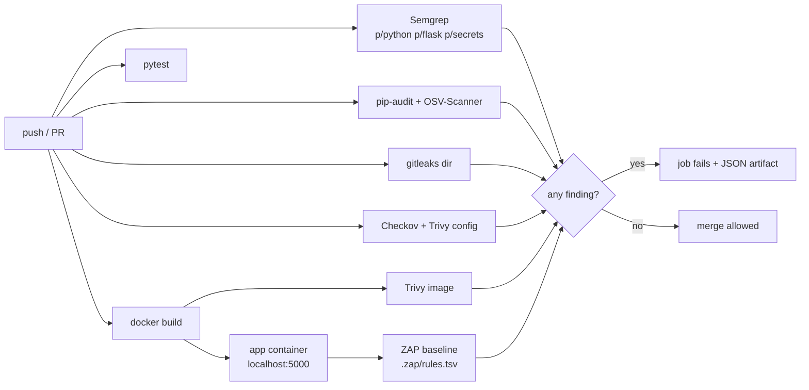

# devsecops-pipeline

A template repo whose GitHub Actions pipeline gates every push on **SAST** (Semgrep), **SCA** (pip-audit + OSV-Scanner), **secret scanning** (gitleaks), **IaC scanning** (Checkov + Trivy config on Terraform, Kubernetes and the Dockerfile), **container scanning** (Trivy) and **DAST** (OWASP ZAP baseline against the app from [`owasp-vuln-vs-fixed`](https://github.com/braylo-ai/owasp-vuln-vs-fixed), started inside the CI runner). The `main` branch carries planted findings and fails every stage. The `fixed` branch remediates them and passes. Real scanner output for both branches is committed in [`scan-results/`](scan-results/).

## What it is
| Path | `main` (planted) | `fixed` (remediated) |
|---|---|---|
| `src/payments_service/service.py` | 8 planted bugs: SQLi, `shell=True`, `pickle.loads`, `yaml.load`, MD5, `verify=False`, `eval`, `debug=True` on `0.0.0.0` | parameterised SQL, arg-list subprocess + allow-list, JSON, `safe_load`, HMAC-SHA256, TLS on, no eval, loopback |
| `config/settings.py` | 3 hard-coded fake secrets | read from environment |
| `requirements.txt` | 2018–2019 pins (flask 0.12.2, urllib3 1.24.1, …) | current pins, incl. transitive `certifi` / `idna` fixes |
| `infra/terraform/main.tf` | public S3, SSH from `0.0.0.0/0`, public unencrypted RDS with a password in code | KMS, versioning, logging, private RDS with managed password, scoped SG |
| `infra/k8s/deployment.yaml` | privileged, root, `hostNetwork`, `:latest` | non-root, read-only FS, drop ALL caps, limits, probes, digest pin |
| `Dockerfile` | `python:3.8-slim-buster` (EOL), root | multi-stage, Chainguard Python runtime, UID 65532 |
| `target-app/` | runs in `vulnerable` mode | runs in `fixed` mode |

### Planted secrets are fake
Every planted secret contains the marker `PLANTED_FAKE` and uses no real provider format (no `ghp_`, `AKIA`, `sk_live_`, PEM key). A custom rule in [`.gitleaks.toml`](.gitleaks.toml) detects the marker. A test fails the build if any real-provider token shape appears anywhere in the repo, and another checks the gitleaks report is redacted.

## Why
A pipeline that never fails proves nothing. Planting one known bug per scanner class, then fixing it on a branch, shows each gate actually fires, and what "green" costs.

## Architecture


## How it works
- [`.github/workflows/devsecops.yml`](.github/workflows/devsecops.yml) — 7 jobs; each scanner exits non-zero on findings. Reports upload as artifacts even on failure.
- [`scripts/run_local_scans.sh`](scripts/run_local_scans.sh) — the same scanners, run locally, raw JSON into `scan-results/<branch>/`.
- [`scripts/summarize.py`](scripts/summarize.py) — parses each tool's JSON into one gate table (`--gate` exits 1 on any finding). Trivy counts HIGH/CRITICAL only; ZAP counts Medium+.
- [`scripts/dast_lite.py`](scripts/dast_lite.py) — local stand-in for ZAP (see Limits): 7 header, cookie and reflected-XSS checks named after the matching ZAP rule ids. Refuses any non-localhost target.
- [`.zap/rules.tsv`](.zap/rules.tsv) — promotes the header/cookie rules to FAIL in the CI baseline.

## Results
Local run, 2026-11-10, macOS. Tools: Semgrep 1.184.0, pip-audit 2.10.1, OSV-Scanner 2.7.0, gitleaks 8.30.1, Checkov 3.4.3, Trivy 0.76.2. Raw files: [`scan-results/main/`](scan-results/main/), [`scan-results/fixed/`](scan-results/fixed/).

| Stage | Tool | `main` findings | `fixed` findings |
|---|---|---|---|
| SAST | Semgrep | 11 | 0 |
| SCA | pip-audit | 78 | 0 |
| SCA | OSV-Scanner | 80 | 0 |
| Secrets | gitleaks (working tree) | 4 | 0 |
| IaC | Checkov (failed checks) | 35 | 0 (37 passed, 3 skipped with reasons) |
| IaC/Dockerfile | Trivy config (HIGH+) | 13 | 0 |
| Container | Trivy image (HIGH+, fixable) | 18 | 0 |
| DAST (local) | dast-lite (failed checks of 7) | 7 | 0 |
| **Gate** | | **8/8 stages FAIL** | **8/8 stages PASS** |

What the numbers show:
- **Semgrep caught 6 of the 8 planted bug classes** (SQLi, shell injection, `yaml.load`, MD5, `eval`, debug/0.0.0.0). It did **not** flag `pickle.loads(request.data)` or `requests.get(..., verify=False)` with these rule packs. A gate is only as good as its rules.
- **The first "fixed" pass still failed 3 stages.** Current-looking pins had 2026 advisories (urllib3 2.6.3 → 7 pip-audit vulns; transitive `certifi`/`idna` → 4 OSV-only findings pip-audit missed with `--no-deps`), `python:3.12-slim` had 2 fixable HIGH zlib CVEs, and the Werkzeug dev server leaked `Server: Werkzeug/x Python/y` after the app's own header hook. Each was fixed for real (pins, Chainguard runtime, request-handler version string), not suppressed.
- **Deleting a secret does not remove it.** On `fixed`, `gitleaks dir` is clean, but `gitleaks git` still finds all 4 planted values in commit `ef80075` ([`scan-results/fixed/gitleaks-history.json`](scan-results/fixed/gitleaks-history.json)). Real secrets would need rotation.
- **Checkov skips** (3) are written inline with reasons: the AWS-default KMS key policy uses `Resource: "*"`, which in a key policy means "this key".

Tests: **14 passed** (`pytest -q`): 9 gate-logic tests on synthetic JSON, 2 that assert the committed `main` results all FAIL and `fixed` results all PASS, 3 planted-secret hygiene tests.

## Run it
```bash
git checkout main  && ./scripts/run_local_scans.sh main   # every stage fails
git checkout fixed && ./scripts/run_local_scans.sh fixed  # every stage passes
python3 -m pytest -q
```
Needs `semgrep pip-audit osv-scanner gitleaks checkov trivy` on `PATH` (`brew install …`). `dast_lite.py` needs the target app running on `127.0.0.1`.

## Limits / scope
- **The GitHub Actions workflow has not run yet** — the repo is local only and not pushed. Action versions are pinned but unverified in a live run; expect to adjust tags on first push.
- **No ZAP or Docker on the build machine.** Docker is absent and the Homebrew ZAP cask is disabled (fails Gatekeeper). The ZAP baseline stage exists only in CI; the local DAST numbers come from `dast_lite.py`, which is a small passive check set, **not** ZAP.
- **Local container scan covers the base image**, not the built image (no Docker to build). CI scans the built image.
- Scanner counts are point-in-time: advisory databases change daily, so the same pins will show different numbers next month.
- All scanning is local and static, plus a target app bound to `127.0.0.1` (local) or `localhost` inside the CI runner. No external system is scanned. Terraform is never applied.

## License
MIT
